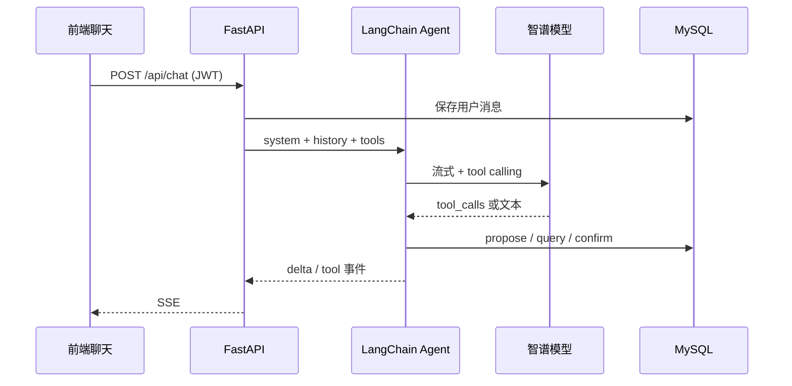

# 模块说明

## 目录结构

```text
AIBookKeeping/
  README.md                 总览与快速开始
  docs/
    01-modules.md           本文件：模块职责
    02-phases.md            阶段一～四如何在代码中落地
    03-setup.md             逐步操作手册
    04-case-multi-bill.md   案例：一句话拆成多笔记账
    05-confirm-buttons.md    说明：确认和取消按钮属于哪一块能力
    06-case-amount-without-yuan.md  案例：没写「元」也要先建草稿
  abkbackend/               Python 后端（FastAPI + MySQL + LangChain）
  abkfrontend/              Vite + Vue 3 + TypeScript 前端
```

## 后端 `abkbackend`

| 模块 | 路径 | 职责 |
| --- | --- | --- |
| 配置 | `app/config.py` | 读取 `.env`：智谱 Key、MySQL、JWT、预算阈值 |
| 数据库 | `app/database.py` `app/models.py` | SQLAlchemy 模型：用户、字典、记账、对话、待确认动作 |
| 鉴权 | `app/auth.py` `routers/auth.py` | 注册/登录、密码哈希、JWT、`get_current_user` |
| 字典 | `app/seed.py` `routers/categories.py` | 收入/支出事项编码，支持新增 |
| 记账 | `services/records.py` `routers/records.py` | 增删查、时间线、周/月/年统计；金额用「分」存储 |
| 对话存储 | `services/chat_store.py` | 会话、消息、pending 确认动作 |
| Agent | `app/agent/*` | Model + Harness + Tools 的记账助手 |
| HTTP 入口 | `app/main.py` | CORS、建表、种子数据、挂载路由 |

### 数据表

1. **users**：账号、密码哈希、头像、姓名、性别  
2. **categories**：编码、中文名、英文名、记账类型（income/expense）  
3. **records**：用户、日期、类型、事项编码、金额（分）、备注  
4. **conversations / chat_messages**：AI 对话历史  
5. **pending_actions**：写入/删除前的待确认草稿（确认流）

### Agent 工具（Tools）

| 工具 | 作用 |
| --- | --- |
| `list_categories` | 读字典 |
| `query_records` | 读记账 |
| `propose_create_record` | 提出写入草稿（不落库） |
| `propose_delete_record` | 提出删除草稿（不落库） |
| `confirm_pending_action` | 用户确认后真正写入/删除 |
| `cancel_pending_action` | 取消草稿 |
| `add_category` | 新增字典项 |
| `check_budget` | 查询某类本月支出（预算中间件会用） |

**安全边界**：`user_id` 由登录态注入工具闭包，模型无法伪造别人的数据。

## 前端 `abkfrontend`

| 模块 | 路径 | 职责 |
| --- | --- | --- |
| API | `src/api/*` | REST + SSE 流式聊天 |
| 鉴权 | `composables/useAuth.ts` | token、登录注册、当前用户 |
| 聊天 | `composables/useChat.ts` + `ChatTab.vue` | Tab1：与 AI 对话记账 |
| 时间线 | `TimelineTab.vue` | Tab2：按日期展示收支 |
| 我的 | `ProfileTab.vue` + `LineChart.vue` | Tab3：账号信息 + 周/月/年曲线 |
| 布局 | `App.vue` + `styles/main.css` | 底部三 Tab，适配移动端与 PC |

## 关键数据流


